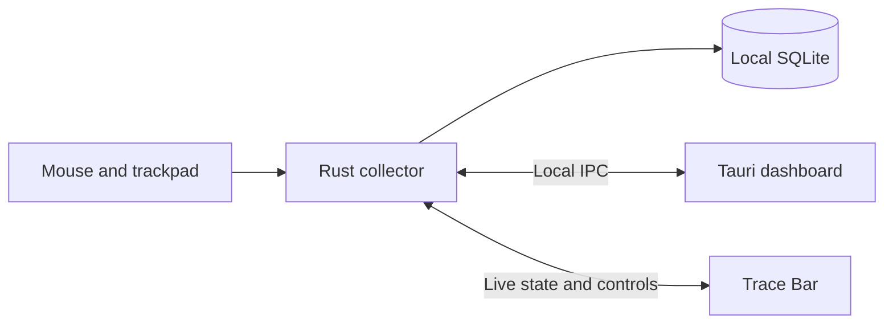

# Development

Trace's native collector and desktop host currently target Windows 10/11 x64. The shared Rust metrics/storage code and browser UI can be developed separately, but a browser preview does not capture global input.

## Requirements

- Node.js 22 or newer and npm.
- Rust stable with the Windows MSVC toolchain.
- Visual Studio C++ Build Tools with the Windows SDK.
- Microsoft Edge WebView2 Runtime for the native UI.

Install dependencies and start the complete desktop application from the repository root:

```text
npm ci
npm run desktop
```

The launcher builds the collector sidecar, starts Vite and opens the Tauri host. Tracking and startup remain disabled until the user chooses them. Keep developer tooling separate from the public installer instructions in the project README.

## Browser development

```text
npm run dev
```

Open [localhost:1420](http://127.0.0.1:1420). On Windows, the development bridge can connect to an available debug or portable collector. This uses the current user's real Trace database. Use preview mode to work on the UI without that connection:

```powershell
$env:TRACE_BROWSER_PREVIEW = "1"
npm run dev
```

For Command Prompt, set the variable with `set TRACE_BROWSER_PREVIEW=1` before running the same npm command. The flag applies to that terminal session. Static builds and non-Windows browsers provide UI previews only.

## Commands

| Command                                                   | Purpose                                                     |
| --------------------------------------------------------- | ----------------------------------------------------------- |
| `npm run build`                                           | Type-check and build both UI entries.                       |
| `npm test`                                                | Frontend unit tests.                                        |
| `npm run test:bridge`                                     | Local bridge tests.                                         |
| `npm run test:ui`                                         | Playwright regressions.                                     |
| `cargo test --workspace --exclude trace-desktop --locked` | Collector and shared Rust tests.                            |
| `npm run status`                                          | Inspect collector connectivity and saved settings.          |
| `npm run test:windows`                                    | Windows capture/storage smoke checks.                       |
| `npm run test:bar`                                        | Isolated collector, focus and live-state smoke checks.      |
| `npm run installer`                                       | Build the standard Windows setup package.                   |
| `npm run site:build`                                      | Prepare the static download website and verified installer. |

Before the first browser test run:

```text
npx playwright install chromium
```

Native smoke tests require a built collector and may move the pointer briefly. Follow the [test plan](TEST_PLAN.md); the older Windows smoke test requires no existing collector, while the Trace Bar smoke test uses its own instance and database. Performance sampling is available through `scripts/measure-collector.ps1` and is a manual hardware check.

## Architecture



| Directory              | Responsibility                                            |
| ---------------------- | --------------------------------------------------------- |
| `crates/trace-core`    | Shared events, settings, statistics and docking geometry. |
| `crates/trace-metrics` | Movement, activity, focus and insight calculations.       |
| `crates/trace-storage` | SQLite, migrations, history, retention and exports.       |
| `crates/trace-ipc`     | User-scoped commands and bounded live delivery.           |
| `crates/trace-agent`   | Windows capture, worker, tray and lifecycle.              |
| `apps/desktop`         | Tauri host, dashboard and separate bar frontend.          |
| `migrations`           | Versioned database schema.                                |
| `website`              | Public download page.                                     |

The collector owns input capture and persistence. Views share its state, so running both does not duplicate capture. The bar receives in-memory snapshots and does not poll SQLite or load the dashboard chart bundle. Historical queries and exports go through the collector.

Tauri generates `apps/desktop/src-tauri/gen/` during its build. Those schemas, sidecar binaries, caches, local databases and installer outputs are excluded from Git. Keep the authored capability declaration in `apps/desktop/src-tauri/capabilities/default.json` under version control.

## Advanced launch options

These options apply to a built `trace.exe`; they are not installation requirements:

| Option       | Behavior                                            |
| ------------ | --------------------------------------------------- |
| No option    | Open the dashboard and apply saved bar preferences. |
| `--show-all` | Open the dashboard and expanded bar.                |
| `--show-bar` | Open or expand the bar.                             |
| `--bar-only` | Open the bar without a dashboard.                   |
| `--settings` | Open Settings.                                      |

Before switching between local builds, stop the old collector from its tray and close its views. A portable build must keep `trace.exe`, `trace-agent.exe` and its required WebView2 loader together. The repository no longer distributes a root launcher tied to one developer's ignored `dist/Trace-Bar` directory.

## Troubleshooting

- **No activity:** enable tracking and check pause/incognito. `npm run status` reports the collector state.
- **Missing bar:** open it from the dashboard header or Settings; its collapsed form is a small screen-edge tab. Fullscreen hiding and saved monitor settings also affect visibility.
- **Collector unavailable:** use Reconnect and inspect `%LOCALAPPDATA%\Trace\trace.log`. Reinstall missing packaged files using the published setup.
- **Compiler/linker missing:** verify the MSVC C++ toolchain and Windows SDK are installed. VS Code alone does not provide them.
- **Application Control blocks execution:** a successful build does not establish Windows trust. Do not disable device security. Public distribution needs a trusted publisher signature; see [release requirements](RELEASING.md).

The legacy Linux/MinGW contingency in `scripts/build-windows-container.sh` and `scripts/installer.nsi` is retained for maintainers who cannot build natively. It needs Rust, the Windows GNU target, MinGW and NSIS in the container, plus a built frontend. Its fallback installer requires an existing WebView2 Runtime and has not replaced the verified Windows release workflow.
